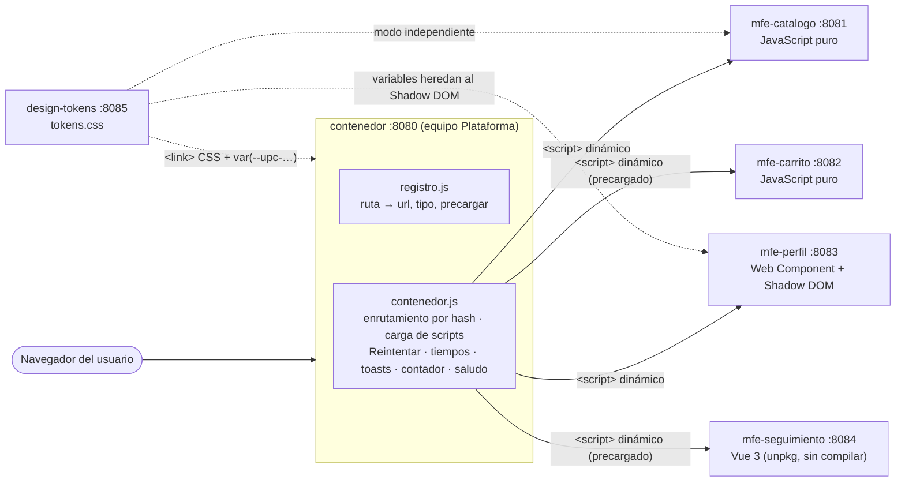
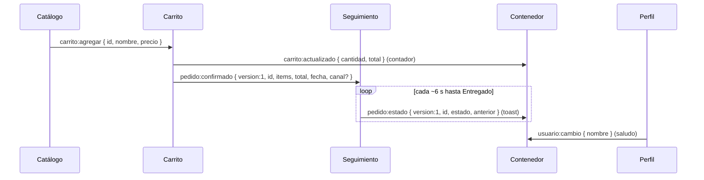

# SaborUPC 2.0 — contenedor

Aplicación contenedora de **SaborUPC**, una tienda de comida típica armada con micro frontends que se
desarrollan, ejecutan y despliegan por separado. Este repo contiene el contenedor, el servidor de
desarrollo (`scripts/start-all.js`), el script de despliegue independiente (`scripts/desplegar.js`) y los
contratos entre equipos ([CONTRATOS.md](CONTRATOS.md)). Cada pieza es **su propio repositorio git**.

- Taller base (v1.0.0): contenedor + Catálogo + Carrito + Perfil, según la guía de Jackson (2019).
- SaborUPC 2.0 (Actividad 2): agrega **Seguimiento de pedidos** (Vue 3), contratos versionados, pruebas de
  contrato, sistema de diseño compartido, resiliencia con Reintentar, tiempos de carga y despliegue
  independiente.

## Arquitectura



Las piezas **nunca se importan entre sí**. Se hablan solo con eventos en `window`:



## Puertos y URL

| Pieza | Carpeta (repo) | Puerto | URL | Tecnología |
|---|---|---|---|---|
| Contenedor | `contenedor/` | 8080 | http://localhost:8080 | JS puro |
| Catálogo | `mfe-catalogo/` | 8081 | http://localhost:8081 (modo independiente) | JS puro |
| Carrito | `mfe-carrito/` | 8082 | http://localhost:8082 (modo independiente) | JS puro |
| Perfil | `mfe-perfil/` | 8083 | http://localhost:8083 (modo independiente) | Web Component |
| Seguimiento | `mfe-seguimiento/` | 8084 | http://localhost:8084 (modo independiente) | Vue 3 por CDN |
| Tokens de diseño | `design-tokens/` | 8085 | http://localhost:8085/tokens.css | CSS |

Pruebas de contrato (sin contenedor): `http://localhost:<puerto>/contrato.html` para 8081, 8082, 8083 y 8084.

## Cómo ejecutar

Requisitos: Node 18+ y un navegador moderno. No hay dependencias que instalar. Seguimiento necesita
internet para descargar Vue desde `unpkg.com`.

Los repos deben estar como carpetas hermanas (así el servidor los encuentra):

```
taller-microfrontends/
├── contenedor/   mfe-catalogo/   mfe-carrito/   mfe-perfil/   mfe-seguimiento/   design-tokens/
```

Todo junto (desde `contenedor/`):

```bash
npm run start:all
```

Solo algunas piezas (sirve para simular la caída de una y volver a encenderla):

```bash
node scripts/start-all.js --sin perfil          # todo menos Perfil
node scripts/start-all.js --solo perfil         # únicamente Perfil
node scripts/start-all.js --sin perfil,tokens   # varias, separadas por coma
```

Claves: `contenedor`, `catalogo`, `carrito`, `perfil`, `seguimiento`, `tokens`. Si un puerto está ocupado, el
servidor lo dice y sigue con los demás. Cada servidor entrega los MIME correctos y `Cache-Control: no-store`.

Desplegar una nueva versión de un solo MFE (cambia `VERSION` y un cambio visible, y hace commit **solo** en
su repo):

```bash
node scripts/desplegar.js catalogo 1.1.0        # o: npm run desplegar -- catalogo 1.1.0
```

Recargue http://localhost:8080 y verá la nueva versión sin haber reiniciado ningún servidor. Para deshacer
la demostración: `git -C ../mfe-catalogo reset --hard HEAD~1`.

## Decisiones y justificación

**Eventos frente a llamadas directas.** Los MFE se comunican con `CustomEvent` en `window`. Quien publica no
sabe quién escucha, así que ningún equipo importa código de otro ni comparte estado, y se puede reemplazar
o apagar una pieza sin romper a las demás. El costo: el contrato vive en un documento y en pruebas, no en el
compilador. Por eso existen `CONTRATOS.md` y los `contrato.html`.

**Precarga (`precargar: true`) para Carrito y Seguimiento.** Ambos guardan estado y escuchan eventos desde
que se carga su script, no cuando se montan: el Carrito cuenta platos aunque no esté en pantalla y
Seguimiento mantiene sus temporizadores y sus pedidos. Por eso su estado vive a nivel de módulo y `render`
solo pinta lo que ya existe. Alternativa descartada: que el contenedor guarde esos datos (le daría
conocimiento de dominio que no le corresponde).

**Seguimiento con Vue 3 por CDN.** Demuestra heterogeneidad: otro equipo, otra tecnología, el mismo contrato
de montaje. Se usa la versión fija `3.5.13` en su build ES de navegador (incluye el compilador de plantillas,
así que no hay paso de compilación) y se carga con `import()` desde el propio MFE justo antes de montar.
Al ser un módulo ES no crea una variable global `Vue`, así que no puede chocar con otro MFE. Los timers y
pedidos no dependen de Vue; la vista se suscribe al estado mientras está montada y se desuscribe al
desmontar (`app.unmount()`).

**Aislamiento de CSS.** Catálogo, Carrito y Seguimiento usan prefijo (`cat-`, `car-`, `seg-`), el contenedor
usa `app-`, y Perfil usa Shadow DOM. Se probó agregando `button { background: black; }` en el CSS del
contenedor: no afecta a Perfil ni a los MFE con prefijo (sus reglas de clase pesan más que el selector de
elemento). El prefijo es una convención que puede violarse; el Shadow DOM es una garantía del navegador.

**Sistema de diseño (`design-tokens`, 8085).** Un repo propio publica solo variables `--upc-*`. Los
consumidores las usan como `var(--upc-…, valor-de-respaldo)` con el valor original de la guía, así el modo
independiente y la caída del servidor de tokens no cambian el aspecto. Las variables CSS atraviesan el
Shadow DOM, que es la forma correcta de tematizar a Perfil sin romper su encapsulamiento.

**Versionado de contratos.** `pedido:confirmado` y `pedido:estado` llevan `version: 1`. Regla: solo se
agregan campos opcionales; un cambio incompatible es una nueva versión, y los consumidores ignoran las
versiones que no conocen. `canal` se agregó a `pedido:confirmado` como demostración y hay pruebas
automáticas de que Seguimiento funciona con y sin ese campo. Los tres eventos de la guía no tienen campo
`version` (se tratan como v1 implícita) para no cambiar contratos existentes.

**Resiliencia y observabilidad.** Si un MFE no carga, el contenedor muestra un mensaje y un botón
**Reintentar** que vuelve a descargar el script sin recargar la página (`cargarScript` descarta la promesa
fallida). Cada carga, o fallo, escribe en consola `[SaborUPC] Catalogo cargado en 12.3 ms`, medido con
`performance.now()`.

**Servidor de desarrollo propio.** `start-all.js` usa solo `http` y `fs`, funciona en Windows y permite
levantar o apagar cada MFE por separado, que es lo que hace falta para simular caídas.

## Límites conocidos

- Un script ya cargado no se vuelve a descargar al navegar entre secciones: una versión nueva de un MFE se
  ve **al recargar la página** (que reinicia el estado en memoria, como el carrito y los pedidos).
- Los pedidos viven en memoria: se pierden al recargar, y su `id` se reinicia en cada sesión del Carrito.
- Seguimiento depende de `unpkg.com` en tiempo de ejecución. Si el CDN no responde, muestra un mensaje y
  reintenta la descarga la próxima vez que se entra a la sección.
- El tiempo de carga que se registra es el del script de cada MFE; la descarga diferida de Vue no se incluye.

## Documentación

- [CONTRATOS.md](CONTRATOS.md): contrato de montaje, tabla de eventos, regla de evolución.
- [docs/GUION_VIDEO.md](docs/GUION_VIDEO.md): guion del video (máximo 5 minutos).
- [docs/NOTAS_REFLEXION.md](docs/NOTAS_REFLEXION.md): hechos registrados durante el desarrollo.
